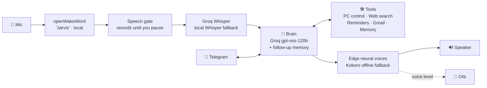

<div align="center">


# 🎙️ J.A.R.V.I.S.

### *Your own Iron-Man style voice assistant for Windows — Hindi + English, hands-free.*

Say **"Jarvis"** → it answers **"Yes, Master."** → a glowing orb appears → just talk.


[Features](#-what-it-can-do) · [Demo](#-the-orb) · [Setup](#-setup-15-minutes) · [Commands](#-try-saying) · [How it works](#-how-it-works) · [Roadmap](#-roadmap)

</div>

---

## ✨ What it can do

| | Feature | Example |
|---|---|---|
| 👂 | **Wake word, no button** — always listening offline for "Jarvis" | *"Hey Jarvis"* |
| 💬 | **Keeps talking** — no wake word between follow-ups; sleeps on *"Stop Jarvis"* or 60 s of silence | *"Weather in Delhi" → "and Mumbai?"* |
| ✋ | **Interrupt anytime** — say "Jarvis" while it talks and it stops to listen | *"Jarvis!"* |
| 🎧 | **Polite audio** — soft chime when it's your turn, music turned down while you talk, adapts to room noise | |
| 🔮 | **Animated orb** — floating, click-through, changes colour while listening / thinking / speaking, pulses with its own voice | see below |
| 🇮🇳 | **Hindi & Hinglish** — replies in the language you used, with a Hindi voice | *"आज मौसम कैसा है?"* |
| 🖥️ | **Controls your PC** — apps, websites, folders, volume, media, brightness, screenshots, typing, lock | *"Open Downloads"*, *"Volume up"* |
| ▶️ | **Plays the exact video** — finds and plays the first YouTube result | *"Play Kesariya on YouTube"* |
| 🌦️ | **Live info** — weather, web search, news | *"What's happening in India today?"* |
| 📧 | **Reads your Gmail aloud** — read-only, never marks mail as read | *"Any unread mail from Amazon?"* |
| ⏰ | **Reminders** — survive restarts, spoken + sent to your phone | *"Remind me in 20 minutes to call Mom"* |
| 🧠 | **Remembers you** — saves personal facts you tell it | *"Remember my birthday is 3rd March"* |
| ☀️ | **Morning briefing** — weather, top news, reminders, unread mail | *"Good morning Jarvis"* |
| 📱 | **Telegram remote** — control your PC from your phone (only your chat ID) | message your bot *"lock my PC"* |
| 🤖 | **Talks to other AIs** — hands your question to ChatGPT or Claude | *"Ask Claude to write a poem"* |
| 🔒 | **Safe by design** — allowlisted actions only; shutdown/restart need a spoken *"yes"* | *"Shut down" → "Are you sure?"* |

---

## 🔮 The orb

<div align="center">

| Listening | Thinking | Speaking |
|:---:|:---:|:---:|
|  |  |  |
| reacts to your mic level | swirls while the AI works | pulses with every word |

</div>

Frameless, always on top, never steals your clicks — fades in at the bottom of your screen and fades out when Jarvis goes to sleep.

---

## 🚀 Setup (≈15 minutes)

### 1. Install the tools

| Tool | Why | Get it |
|---|---|---|
| **Git** | clone the repo | `winget install Git.Git` |
| **uv** | Python + packages (Python 3.13 is installed for you) | `winget install astral-sh.uv` |
| **Rust 1.89** | builds the OpenJarvis core | `winget install Rustlang.Rustup` |
| **VS Build Tools** (C++ workload) | Rust compiler on Windows | `winget install Microsoft.VisualStudio.2022.BuildTools` |

### 2. Clone (with the OpenJarvis submodule)

```powershell
git clone --recurse-submodules https://github.com/sagarjain03/jarvis.git D:\jarvis
cd D:\jarvis\OpenJarvis
uv sync --managed-python --python 3.13 --extra desktop --extra voice --extra inference-litellm --group desktop-native
uv run jarvis init --engine ollama
```

> 💡 Cloned somewhere other than `D:\jarvis`? Update the path in `assistant\start-jarvis.cmd`.

### 3. Get a free Groq key — the brain 🧠

Create one at **[console.groq.com/keys](https://console.groq.com/keys)** and save it as a Windows environment variable (it never goes in a file):

```powershell
[Environment]::SetEnvironmentVariable('GROQ_API_KEY', '<your key>', 'User')
```

Then point OpenJarvis at Groq in `%USERPROFILE%\.openjarvis\config.toml`:

```toml
[engine]
default = "litellm"

[intelligence]
default_model = "groq/openai/gpt-oss-120b"

[speech]
model = "base"          # offline speech-to-text fallback
tts_backend = "kokoro"  # free, local voice
voice_id = "bm_george"  # British male — very Jarvis
```

### 4. Launch 🎉

Double-click **`assistant\start-jarvis.cmd`** (or make a desktop shortcut to it).
First start downloads the wake-word model and warms up the voice (~30 s). When you hear *"Jarvis online"* — say **"Jarvis"**.

<details>
<summary><b>📧 Optional: read Gmail aloud</b></summary>

1. Turn on 2-Step Verification in your Google account.
2. Create an **App Password** at [myaccount.google.com/apppasswords](https://myaccount.google.com/apppasswords).
3. Save both as environment variables — **never commit them**:

```powershell
[Environment]::SetEnvironmentVariable('GMAIL_ADDRESS', '<you>@gmail.com', 'User')
[Environment]::SetEnvironmentVariable('GMAIL_APP_PASSWORD', '<app password>', 'User')
```
</details>

<details>
<summary><b>📱 Optional: control from your phone (Telegram)</b></summary>

1. Talk to [@BotFather](https://t.me/BotFather) → `/newbot` → copy the token.
2. `[Environment]::SetEnvironmentVariable('TELEGRAM_BOT_TOKEN', '<token>', 'User')`
3. Start Jarvis and message your bot — it replies with **your chat ID** (setup mode).
4. `[Environment]::SetEnvironmentVariable('TELEGRAM_ALLOWED_CHAT_ID', '<your id>', 'User')`
5. Restart Jarvis. Only that chat can control your PC.
</details>

<details>
<summary><b>🔐 Optional: fully private / offline mode</b></summary>

- Speech-to-text: set `CLOUD_STT = False` in `assistant/hey_jarvis.py` (uses local Whisper; slower).
- Brain: install [Ollama](https://ollama.com), set `[engine] default = "ollama"` and a local model like `qwen3.5:2b`.
- Voice: set `CLOUD_TTS = False` in `assistant/hey_jarvis.py` (local Kokoro; slower on weak CPUs).
- The wake word is always 100 % local.
</details>

---

## 🗣️ Try saying

```text
"Jarvis"                                   → "Yes, Master."
"Open YouTube and play Believer"           → plays the video
"What's the weather in Indore?"            → live weather
"Open my Downloads folder"                 → opens it
"Set brightness to 40"                     → done
"Remind me at 6:30 pm to go to the gym"    → reminder saved
"Read my unread emails"                    → reads sender + subject
"Ask ChatGPT how black holes form"         → opens ChatGPT with the question
"मेरा नाम याद रखो, मैं सागर हूँ"               → saved to memory
"Good morning"                             → full briefing
"Stop Jarvis"                              → "Goodbye, Master."
```

---

## 🧩 How it works



| File | Role |
|---|---|
| [`assistant/hey_jarvis.py`](assistant/hey_jarvis.py) | Main loop: wake word → listen → think → speak |
| [`assistant/brain.py`](assistant/brain.py) | Agent, system prompt, memory, rate-limit retries |
| [`assistant/pc_control.py`](assistant/pc_control.py) | Allowlisted PC actions + power confirmation gate |
| [`assistant/stt.py`](assistant/stt.py) | Speech-to-text (Groq → local fallback) |
| [`assistant/orb.py`](assistant/orb.py) · [`orb_client.py`](assistant/orb_client.py) | The animated orb (PySide6) and its controller |
| [`assistant/session.py`](assistant/session.py) | Stop phrases, silence detection, idle timeout |
| [`assistant/reminders.py`](assistant/reminders.py) | Natural-language reminders ("tomorrow 9 am") |
| [`assistant/email_reader.py`](assistant/email_reader.py) | Read-only Gmail over IMAP |
| [`assistant/telegram_bot.py`](assistant/telegram_bot.py) | Phone control, locked to your chat ID |
| [`assistant/wrapped_tools.py`](assistant/wrapped_tools.py) | Thread-safe memory + compact web search |

### ⚡ Speed

| Step | Time |
|---|---|
| "Yes, Master." | instant (pre-recorded at start-up) |
| Your speech → text | ~0.4 s (Groq) |
| Thinking | ~2–3 s (Groq) |
| Voice per sentence | ~1.6 s (Edge), streamed sentence by sentence |

---

## 🛡️ Safety

- **No free-form commands.** Jarvis can only open apps, sites and folders from fixed allowlists.
- **Power actions need confirmation.** "Shut down" → *"Are you sure?"* → you must say *"yes"* within 30 s.
- **Secrets live only in environment variables.** Nothing is written to the repo.
- **Telegram is locked** to the chat ID you choose. Unknown chats are ignored.
- **Gmail is read-only.** Mail is opened in read-only mode and is never marked as read.

---

## 🧪 Tests

```powershell
cd D:\jarvis\assistant
uv run --project D:\jarvis\OpenJarvis --with pytest pytest -q -p no:cacheprovider
```

**218 tests.** All logic is tested without a mic, speakers or network.

---

## 🗺️ Roadmap

Coming next (full list in [`assistant/todo.md`](assistant/todo.md)):

- [x] 🛑 Interrupt Jarvis mid-sentence by saying "Jarvis"
- [x] ⚡ Faster natural voices (Edge TTS, Hindi neural voices)
- [ ] 👀 "What's on my screen?" — vision
- [ ] 📋 Clipboard summarize / translate
- [ ] 🔎 Find & open files by name
- [ ] 🎬 Routines — "work mode", "night mode"
- [ ] 📅 Google Calendar in the morning briefing
- [ ] 📝 To-do list synced with Telegram
- [ ] 🔋 Proactive alerts (battery, meetings)
- [ ] 🖱️ System tray icon

---

## 🙏 Credits

- Built on **[OpenJarvis](https://github.com/open-jarvis/OpenJarvis)** (Apache 2.0) — the agent framework, voice, and tooling, included as a git submodule.
- [Groq](https://groq.com) · [openWakeWord](https://github.com/dscripka/openWakeWord) · [Kokoro TTS](https://huggingface.co/hexgrad/Kokoro-82M) · [faster-whisper](https://github.com/SYSTRAN/faster-whisper) · [PySide6](https://doc.qt.io/qtforpython-6/)

<div align="center">

**Made with ☕ by [Sagar Jain](https://github.com/sagarjain03)**

*"Sometimes you gotta run before you can walk."*

</div>
